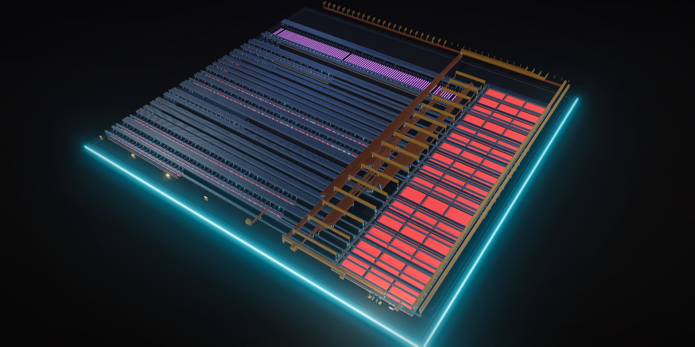
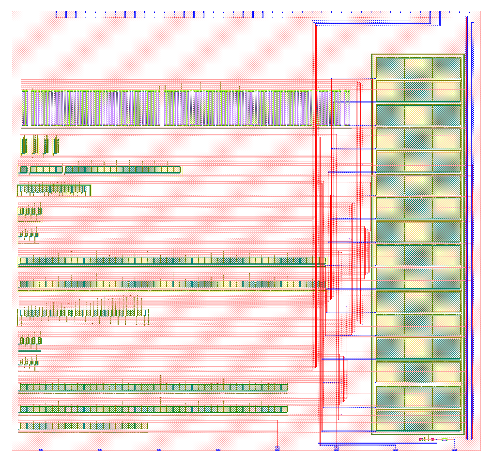

# Analog Circuits for Music Synthesis
## Tapeout 1: Transistor-Ladder / 4-pole MOS ladder VCF

A Moog-type resonant low-pass filter built as an NMOS transistor ladder in weak
inversion. The cutoff is set by one current pin, and the resonance is a 4-bit DAC
that can drive the filter into self-oscillation.

The circuit follows the transistor-ladder VCF as taught in Georgia Tech's ECE 4450
Analog Circuits for Music Synthesis (Prof. Aaron Lanterman), moved from
discrete BJTs to MOSFETs on a 180 nm die.

This design also applied matching techniques from the layout chapter of Razavi's *Design
of Analog CMOS Integrated Circuits* to the whole design.

All numbers are **post-layout**: extracted layout with C + coupling C, typical corner, 27 °C,
VDPWR = 3.3 V unless a row says otherwise. Every ua pin goes through the TT analog path
(500 Ω + 5 pF) and the outputs carry 15 pF of board load. Output is read differentially
(OUTP − OUTN).

## Summary

| Parameter | Value |
|---|---|
| Process / area | GF180MCU-D, 1×2 TT tile, 346 × 325 µm |
| Supply | 3.3 V on VDPWR, works 3.0–3.6 V |
| Cutoff range | 17.7 Hz – 48 kHz for IREF = 2.5 nA – 10 µA (11.4 octaves) |
| Tuning law | f₋₃dB ∝ IREF^0.95 (I_f = IREF/32); 7.2 kHz at 1.25 µA, about 5–6 kHz/µA in the upper range |
| Roll-off | 24.2 dB/octave (8× → 16× f₋₃dB) |
| Passband gain | −6.0 to −6.3 dB at the pins (PVT: −5.1 to −6.8 dB) |
| Resonance control | 4-bit, ui_in[3:0]; self-oscillation from code 6–9 (all PVT and MC) |
| Output noise, 20 Hz–20 kHz | 37–46 µV rms (code 0) |
| SNR at 40 mV pk input | ≈ 50 dB |
| THD at 500 Hz | 0.54 % at 10 mV pk, 2.3 % at 40 mV pk |

## Cutoff vs IREF (code 0)

| IREF | f₋₃dB | passband |
|---|---|---|
| 2.5 nA | 17.7 Hz | −6.28 dB |
| 5 nA | 35.3 Hz | −6.16 dB |
| 15 nA | 103 Hz | −6.14 dB |
| 50 nA | 331 Hz | −6.17 dB |
| 150 nA | 963 Hz | −6.18 dB |
| 500 nA | 3.05 kHz | −6.18 dB |
| 1.5 µA | 8.54 kHz | −6.15 dB |
| 5 µA | 25.8 kHz | −6.06 dB |
| 10 µA | 48.0 kHz | −5.98 dB |

- Doubling IREF raises the cutoff by close to one octave: a fit over the whole range gives f₋₃dB ∝ IREF^0.95. The law is nearly exact up to about 1 µA and compresses slightly toward 10 µA as the ladder leaves deep weak inversion.
- Temperature coefficient of the cutoff: −0.25 %/°C (from U_T in the pole equation).
- PVT spread of the cutoff at 27 °C: 15–20 Hz at 2.5 nA, 6.9–7.6 kHz at 1.25 µA, 46–50 kHz at 10 µA.
- At 8× the cutoff the response is 44.8 dB below the passband, and at 16× it is 69.0 dB below.

## Resonance

| Parameter | Value |
|---|---|
| Codes 0–5 | resonant peak, no oscillation |
| Oscillation onset | code 7 typical; 6–9 over 5 corners × 3 temperatures × 3 supplies |
| Onset, Monte Carlo (60 draws) | code 6–9 |
| Onset, Monte Carlo at ss/−20 °C/3.0 V and ff/85 °C/3.6 V | 5–8 / 7–10 |
| Oscillation frequency, code 12 | 1.85 / 17.9 / 106 kHz at IREF 0.1 / 1.25 / 10 µA |
| Oscillation amplitude | 45–59 mV pp (code 12); 46–68 mV pp (code 15, every corner) |
| Resonance collapse (filter dies at high codes) | 0 of 90 PVT cases |
| Cutoff shift with resonance code | none: the DAC current is separate from I_f |

## Signal

| Input (500 Hz, peak) | THD |
|---|---|
| 10 mV | 0.54 % |
| 20 mV | 1.1 % |
| 40 mV | 2.3 % |
| 80 mV | 5.8 % |
| 160 mV | 22 % |

- Recommended input level: 10–40 mV peak, AC-coupled with 1 µF or more.
- Distortion is soft clipping from the tanh-shaped input pair. It also limits the oscillation amplitude.
- Output DC level: about VDD − 0.85 V (2.40 V at 3.3 V) on both outputs.
- Input bias resistance: about 1.4 MΩ (VIN to vcm).

## Noise

Range: 20 Hz–20 kHz

| IREF | code 0 | code 5 (resonant) | SNR at 40 mV pk in, code 0 |
|---|---|---|---|
| 250 nA | 46.5 µV rms | 92.6 µV rms | 49.5 dB |
| 1.25 µA | 43.3 µV rms | 99.2 µV rms | 50.1 dB |
| 10 µA | 36.7 µV rms | 37.5 µV rms | 51.6 dB |

At 10 µA the resonant peak (about 48 kHz) is outside the audio band, so code 5 adds almost nothing.

## References

1. A. Lanterman, *ECE 4450: Analog Circuits for Music Synthesis*, Georgia Tech. Course page: <https://acms.ece.gatech.edu/>; course outline: <https://ece.gatech.edu/courses/course_outline/ECE4450>
2. A. Lanterman, "ECE4450 L22: Moog Ladder Filters Analyzed", lecture video, 2020. <https://www.youtube.com/watch?v=IRxeIEeAAnU> — small-signal derivation of the stage and full-ladder transfer function, pole movement with K, differential ladder, matching, TB-303 diode-ladder variant.
3. A. Lanterman, ACMS Spring 2018 lecture notes, Session 16–17: Transistor & Diode Ladder Filters. <https://acms.ece.gatech.edu/?p=56>
4. R. A. Moog, "Electronic high-pass and low-pass filters employing the base to emitter diode resistance of bipolar transistors", US Patent 3,475,623, filed 10 Oct 1966, granted 28 Oct 1969. <https://patents.google.com/patent/US3475623>
5. T. E. Stinchcombe, "Analysis of the Moog Transistor Ladder and Derivative Filters", 2008. <https://www.timstinchcombe.co.uk/synth/Moog_ladder_tf.pdf>
6. A. Huovilainen, "Non-Linear Digital Implementation of the Moog Ladder Filter", Proc. DAFx-04, Naples, 2004.
7. C. C. Enz, F. Krummenacher, E. A. Vittoz, "An analytical MOS transistor model valid in all regions of operation and dedicated to low-voltage and low-current applications", *Analog Integrated Circuits and Signal Processing*, vol. 8, 1995.
8. B. Razavi, *Design of Analog CMOS Integrated Circuits*, 2nd ed., McGraw-Hill, 2017 (layout and matching chapter).
9. ktm0228, ttgf26c-opamptrim (source of the CDM clamp arrangement). <https://github.com/ktm0228/ttgf26c-opamptrim>